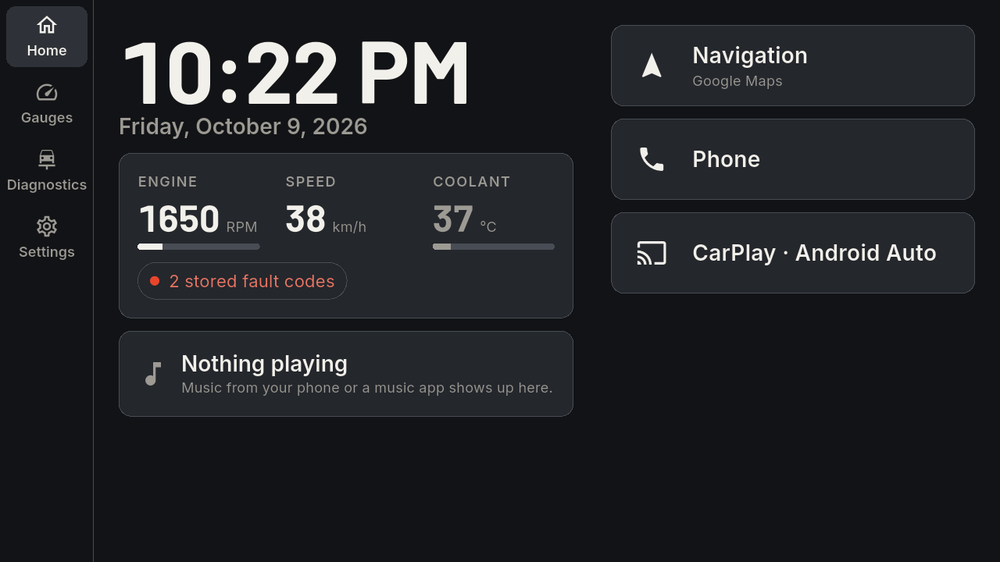
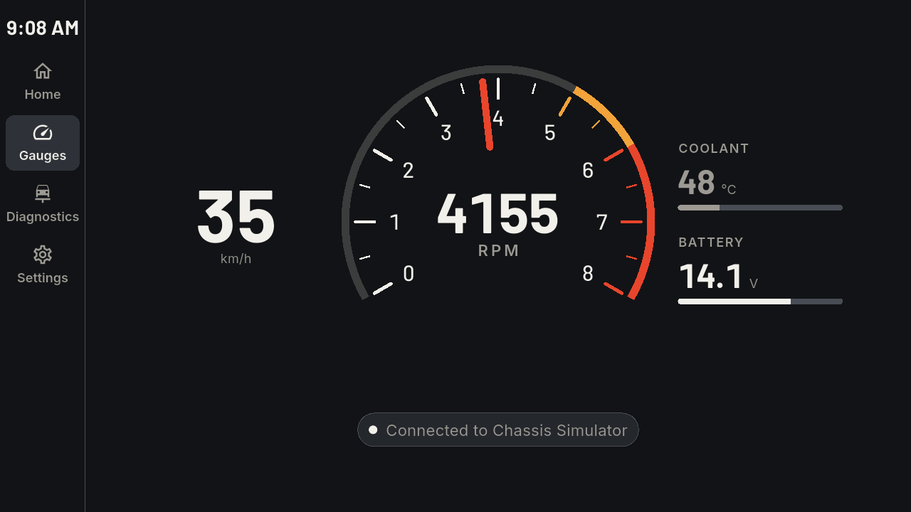
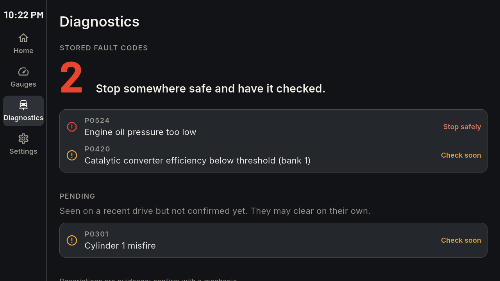

  

<h1 align="center">Retune</h1>

  A touchscreen infotainment system for the 2006 to 2013 Lexus IS350, built on Chassis.

  

The second-generation IS350 without factory navigation came with a small screen you can't touch. Retune replaces it.
It's an Android launcher for an aftermarket head unit, and it reads the car through an OBD-II adapter.

## What it does

- **Gauges that belong in the car.** A tachometer drawn for this engine's 6,600 RPM redline, with speed, coolant and
  battery beside it. Starting the engine plays a short ignition sequence: the needle sweeps to the redline and back,
  like a factory self-test.
- **Fault codes in plain words.** The check-engine light is explained: each stored code with a description and what to
  do about it ("Stop safely", "Check soon" or "No action needed"), with clearing them behind a confirmation.
- **Safe while moving.** Settings and anything that needs your attention wait until the car is parked. Home, the
  gauges, music and navigation never do.
- **The rest of the dash.** Now playing from any music app, launch tiles for navigation, phone, and CarPlay or Android
  Auto, and quick controls for brightness and Bluetooth.
- **Updates over the air.** New releases download in the background and install, while parked, with one tap.

  
  

## Built on Chassis

Chassis is the platform underneath: Dart packages that talk to the car and make sense of what it says, kept separate
from Retune's screens so other apps can use them.

- OBD-II through ELM327 adapters, over Bluetooth LE or classic Bluetooth
- Live readings, fault codes, readiness monitors and freeze frames
- Trips, an estimate of fuel used, and when each service falls due
- A simulated car, so everything can be built and tested away from the real one

Retune only ever reads from the car. The one thing it changes is clearing fault codes, and only when you ask. It never
writes to the CAN bus or touches the airbags, brakes or steering.

## Releases

Signed builds and the update manifest are published in
[retune-releases](https://github.com/retune-auto/retune-releases). The source isn't public yet.

Retune is in active development: everything so far has been built against the simulated car, ahead of fitting it to
a real IS350.
